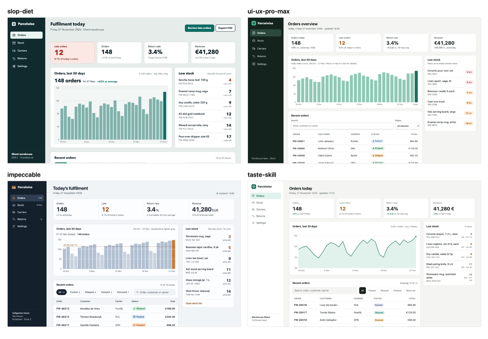
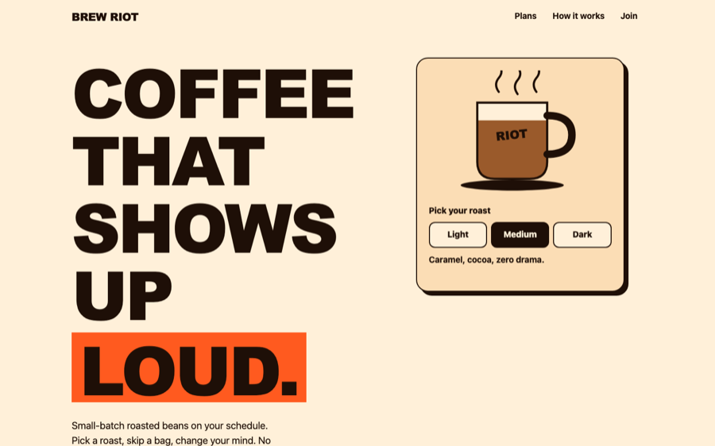
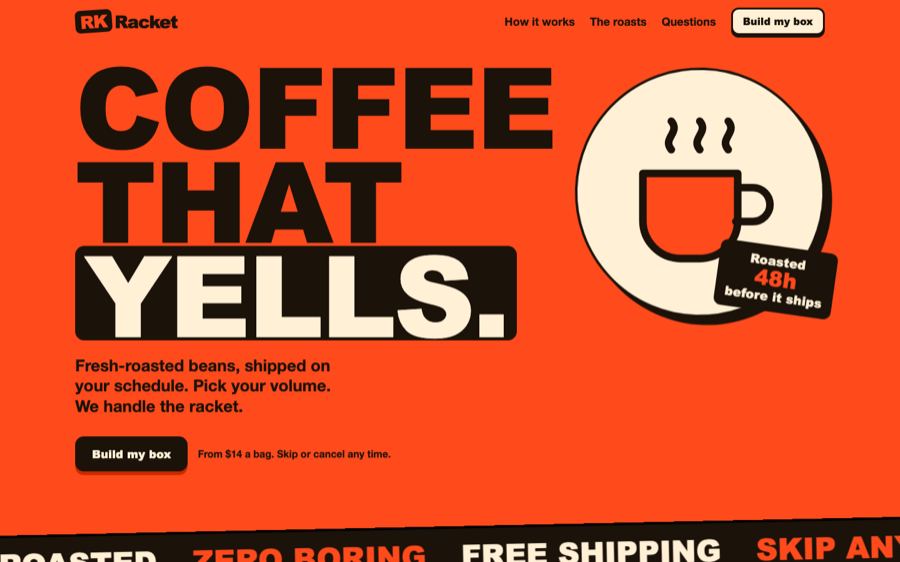
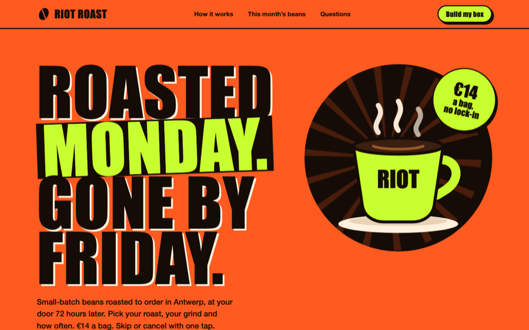

<h1 align="center">slop-diet</h1>

<p align="center"><strong>Checks AI-built pages against UI/UX laws in a real browser. Your prompt or design system keeps the look.</strong></p>

<p align="center">
  <a href="LICENSE"></a>
  
  
  <a href="https://skills.sh"></a>
</p>

<p align="center"></p>

<sub>Same dashboard prompt, one build per skill, Sonnet 5.5.</sub>

## What it does

It turns UI and UX laws into two kinds of checks, then fixes what fails.

**Measured by script**, in a real browser, light and dark, phone and desktop:

- Contrast in every state: rest, hover, focus and selected
- A visible focus ring on every control
- Target size, with no overlapping controls
- No overflow, clipped text or overlap at 320 px
- Reduced motion honoured
- Headings, landmarks and form errors
- AI tells: glow, gradient text, decorative dots, emoji icons

**Judged by a fresh reviewer**, from a screenshot:

- Alignment, equal heights and spacing
- One clear focal point
- Motion with a purpose
- Tactile controls that react to hover and press
- Copy and hierarchy

On 4 fresh prompts, all 8 slop-diet builds passed the law floors. Four other skills and no skill passed 0 of 20.[^n] It costs more and takes longer.

[^n]: Sonnet 5.5, medium effort. Prompts the skill was never tuned on: booking, inbox, pricing, report. Details under [How we measured](#how-we-measured).

<p align="center"></p>

## Install

**Claude Code**

```text
/plugin marketplace add mfsass/skills
/plugin install slop-diet@mfsass-skills
```

**Codex, Cursor and other agents** (with the [Skills CLI](https://skills.sh))

```bash
npx skills add mfsass/skills --skill slop-diet
```

Needs Node 22+ and Chrome (or Playwright). Loads when you build a page, or type `/slop-diet`.

## Get the best out of it

**Pick the model.** Same prompt, three model sizes. Each image is a passing build, picked from 3 per model.

|                                                    Small: Haiku                                                     |                                                             Medium: Sonnet                                                              |                                                   Large: Opus                                                    |
| :-----------------------------------------------------------------------------------------------------------------: | :-------------------------------------------------------------------------------------------------------------------------------------: | :--------------------------------------------------------------------------------------------------------------: |
| [](../../docs/images/slop-diet/model-haiku.png) | [](../../docs/images/slop-diet/model-sonnet.png) | [](../../docs/images/slop-diet/model-opus.png) |
|                                                    $0.11 · 3 min                                                    |                                                              $0.38 · 3 min                                                              |                                                 $0.90 · 4.5 min                                                  |

**Add a `DESIGN.md`.** Your prompt wins, then your `DESIGN.md` or design system, then your existing page. The skill's defaults only fill gaps. A few lines on font, colour and feel are enough.

**Iterate.** Reply `another round`, or add `audit`, `polish`, `bolder` or `calmer`.

## How we measured

<details>
<summary><strong>Method</strong></summary>

- **Prompts:** 4 the skill was never tuned on (booking, inbox, pricing, report).
- **Builds:** Sonnet 5.5, medium effort. 8 builds for slop-diet, 4 for each other setup.
- **Checks:** the script checks above, in a real browser, light and dark, at 390 px and 1440 px.
- **Pass:** no failed law floor and a score of 85 or more.
- **Skills load on their own,** as in daily use. ui-ux-pro-max loaded in 1 of 4 builds, taste-skill in 2 of 4.

| Setup | Passed | Cost per build | Time per build |
|---|---|---|---|
| **slop-diet** | **8 of 8** | $0.63 | 309 s |
| impeccable | 0 of 4 | $0.57 | 226 s |
| ui-ux-pro-max | 0 of 4 | $0.23 | 95 s |
| taste-skill | 0 of 4 | $0.45 | 298 s |
| frontend-design | 0 of 4 | $0.26 | 113 s |
| No skill | 0 of 4 | $0.21 | 85 s |

**Limits:** I wrote these checks alongside the skill. They test laws, not taste. With 4 builds per rival, one build moves a row by 25 points. The hero and model images are extra builds outside this test.

</details>

## Feedback

Open a [GitHub issue](https://github.com/mfsass/skills/issues/new?template=feedback.md). Say what you built, what you expected and what you got.

## Credits

Licences: [LICENSE](LICENSE), [THIRD_PARTY_NOTICES.md](THIRD_PARTY_NOTICES.md).
